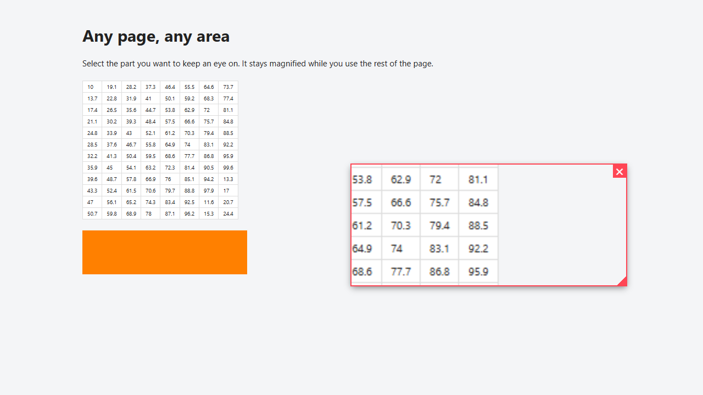

# Web Magnifier

**日本語** | [English](README.md)



Web ページの好きな範囲を、小さなウィンドウに拡大表示し続ける Chrome 拡張機能（Manifest V3）です。ゲーム動画のミニマップ、小さな文字、グラフなど、見ていたい部分をドラッグで囲むと、ページの他の部分を操作している間も拡大したまま表示できます。

## 機能

- YouTube に限らず、一般的な Web ページならどこでも使えます。
- **動画はなめらかで鮮明:** 動画そのものから元の解像度で、毎フレーム描画します。
- **動画以外**（文字・画像・グラフなど）は、タブのスクリーンショットを切り抜いて表示します。更新は1秒に2回ほどです。
- ウィンドウはドラッグで移動、右下の角でサイズ変更できます（縦横比は固定）。
- プレーヤーを全画面にしても使い続けられます。
- 使うまでページを読み取りません。最初からサイトへのアクセス権を求めず、アイコンを押したタブでだけ動きます。

### 操作

| やりたいこと | 操作 |
| --- | --- |
| 範囲選択を始める | アイコンをクリック、または **Alt+Shift+M** |
| 範囲を選ぶ | ページ上をドラッグ |
| 範囲選択をやめる | **Esc**、またはアイコンをもう一度クリック |
| ウィンドウを動かす | ウィンドウをドラッグ |
| サイズを変える | 右下の角をドラッグ |
| ウィンドウを閉じる | ウィンドウの **×** |

新しく範囲を選ぶと、今のウィンドウは置き換わります。ショートカットは `chrome://extensions/shortcuts` で変更できます。

## インストール（Chrome）

Chrome ウェブストアには公開していないため、フォルダを直接読み込みます。1分ほどで終わります。

### 1. ファイルを入手する

**ZIP でダウンロード（Git 不要・おすすめ）**

1. このページ上部の緑色の **`< > Code`** ボタンを押し、**Download ZIP** を選びます。
2. `web-magnifier-main.zip` を展開します。
3. フォルダを、ずっと置いておける場所（`ドキュメント` など）に移します。
   - **注意:** 読み込んだ後にフォルダを移動・削除すると、拡張機能は動かなくなります。

**Git を使う場合**

```bash
git clone https://github.com/nolozy/web-magnifier.git
```

### 2. Chrome に読み込む

1. アドレスバーで `chrome://extensions` を開きます。
2. 右上の **デベロッパー モード** をオンにします。
3. 左上の **パッケージ化されていない拡張機能を読み込む** を押します。
4. **`manifest.json` が直接入っているフォルダ** を選びます。展開するとフォルダが二重（`web-magnifier-main/web-magnifier-main`）になることがあるので、その場合は内側を選びます。
5. 一覧に **Web Magnifier** が表示されれば完了です。

### 3. ピン留めする（任意）

Chrome のツールバーのパズルのアイコン 🧩 から **Web Magnifier** をピン留めすると、アイコンを常に表示できます。

> デベロッパー モードがオンの間は、起動時に拡張機能を無効にするか聞かれることがあります。「キャンセル」を選べばそのまま使えます。

## できないこと

- **Chrome が保護しているページ:** `chrome://` のページ、Chrome ウェブストア、Chrome の PDF ビューアでは使えません。アイコンに `!` が表示されます。
- **DRM 付きの動画**（Netflix など）は黒く表示されます。
- **他サイトから埋め込まれたプレーヤー**（ブログ記事内の YouTube など）は通常のページと同じ扱いになり、更新は1秒に2回ほどです。なめらかに見るには、動画を元のサイトで開いてください。
- 動画以外では画面上の決まった位置を表示するので、スクロールすると映る内容も変わります。また、スクリーンショットを拡大しているため、小さな文字は少しぼやけます。
- `<video>` 要素そのものが全画面になるプレーヤーでは、その上にウィンドウを表示できません。YouTube のようにプレーヤー全体が全画面になるものは問題ありません。

## プライバシー

サーバー、アクセス解析、外部への通信はありません。スクリーンショットはウィンドウの描画にだけ使い、メモリ上に置くだけで、保存も送信もしません。

使う権限は2つです。`activeTab`（アイコンまたはショートカットを使ったタブへのアクセス）と `scripting`（そのタブで動かすため）です。

## ファイル構成

```
web-magnifier/
├── manifest.json     Manifest V3
├── background.js     Service Worker：コンテンツスクリプトの起動とタブのスクリーンショット
├── content.js        範囲選択と拡大ウィンドウ
├── styles.css        範囲選択とウィンドウの見た目
├── icons/            拡張機能のアイコン
├── docs/             この README の画像
├── README.md         英語
└── README.ja.md      日本語
```
