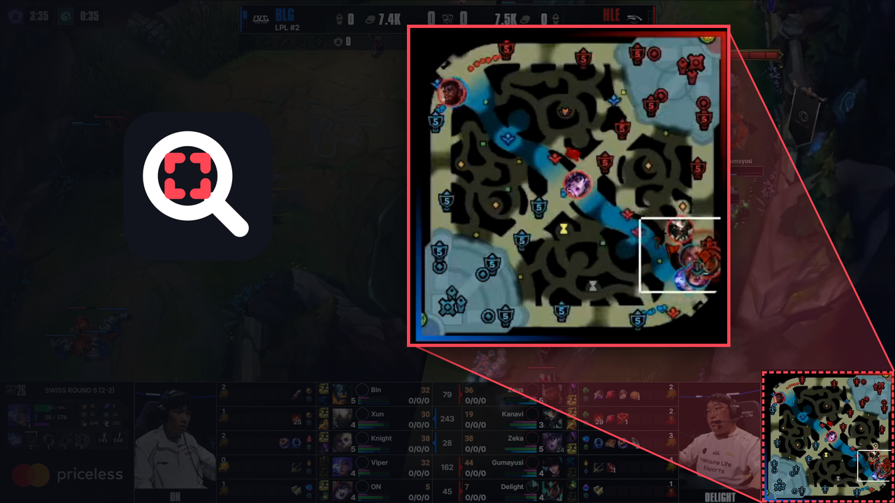

# Web Magnifier

[日本語](README.ja.md) | **English**



A small Chrome extension (Manifest V3) that keeps any area of a web page magnified in a floating window. Drag over the part you want to watch, such as a minimap in a game video, small print or a chart, and it stays enlarged while you use the rest of the page.

## Features

- Works on any regular web page, not only on YouTube.
- **Videos are smooth and sharp:** the window is drawn straight from the video at its own resolution, every frame.
- **Everything else** (text, images, charts and so on) is cropped from a screenshot of the tab, updated about twice per second.
- Move the window by dragging it. Resize it from the bottom right corner; the aspect ratio stays locked.
- Keeps working when the player goes fullscreen.
- Does not read your pages until you use it: the extension asks for no site access up front and only runs on a tab after you click its icon.

### Controls

| Action | How |
| --- | --- |
| Start selecting | Click the icon, or press **Alt+Shift+M** |
| Select an area | Drag on the page |
| Cancel selecting | **Esc**, or click the icon again |
| Move the window | Drag it |
| Resize the window | Drag the bottom right corner |
| Close the window | **×** on the window |

Starting a new selection replaces the current window. To change the shortcut, open `chrome://extensions/shortcuts`.

## Install (Chrome)

The extension is not on the Chrome Web Store, so you load the folder directly. It takes about a minute.

### 1. Get the files

**Download as ZIP (no Git needed, recommended)**

1. Click the green **`< > Code`** button at the top of this page, then **Download ZIP**.
2. Unzip `web-magnifier-main.zip`.
3. Put the folder somewhere permanent (for example in `Documents`).
   - **Note:** if you move or delete the folder after loading it, the extension stops working.

**Or with Git**

```bash
git clone https://github.com/nolozy/web-magnifier.git
```

### 2. Load it in Chrome

1. Open `chrome://extensions` in the address bar.
2. Turn on **Developer mode** (top right).
3. Click **Load unpacked** (top left).
4. Select the folder that **directly contains `manifest.json`**. After unzipping, there may be a folder inside a folder (`web-magnifier-main/web-magnifier-main`), so pick the inner one if needed.
5. **Web Magnifier** should appear in the list.

### 3. Pin it (optional)

Click the puzzle-piece icon 🧩 in Chrome's toolbar and pin **Web Magnifier** so the icon is always visible.

> While Developer mode is on, Chrome may ask on startup whether to disable extensions running in developer mode. Choose "Cancel" and the extension keeps working.

## Limitations

- **Pages Chrome protects:** `chrome://` pages, the Chrome Web Store and Chrome's PDF viewer cannot be used. The icon shows a `!` badge.
- **DRM video** (Netflix and similar services) shows up black.
- **Players embedded from another site** (for example a YouTube player inside a blog post) are treated as regular page content, so they update about twice per second. Open the video on its own site for smooth playback.
- For non-video content the window shows a fixed spot on the screen, so what it shows changes when you scroll. Its picture is an enlarged screenshot, so small text looks slightly soft.
- A fullscreen `<video>` element cannot show other elements on top of it. Players that make their whole container fullscreen, like YouTube's, are fine.

## Privacy

Web Magnifier has no servers, analytics or network requests. Screenshots are used only to draw the window, are kept in memory and are never saved or sent anywhere.

It uses two permissions: `activeTab` (access to the current tab after you click the icon or press the shortcut) and `scripting` (to start in that tab).

## Files

```
web-magnifier/
├── manifest.json     Manifest V3
├── background.js     Service worker: starts the content script and takes the tab screenshots
├── content.js        Area selection and the magnifier window
├── styles.css        Styles of the selection and the window
├── icons/            Extension icons
├── docs/             Image used in this README
├── README.md         English
└── README.ja.md      Japanese
```
